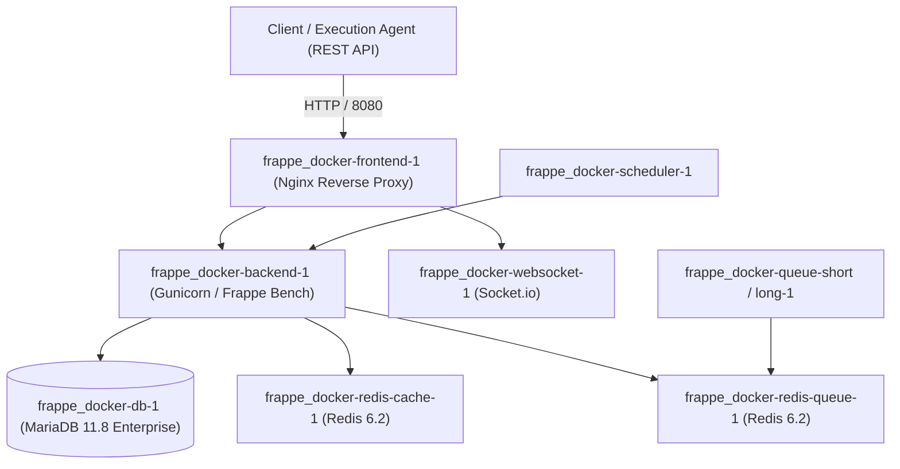
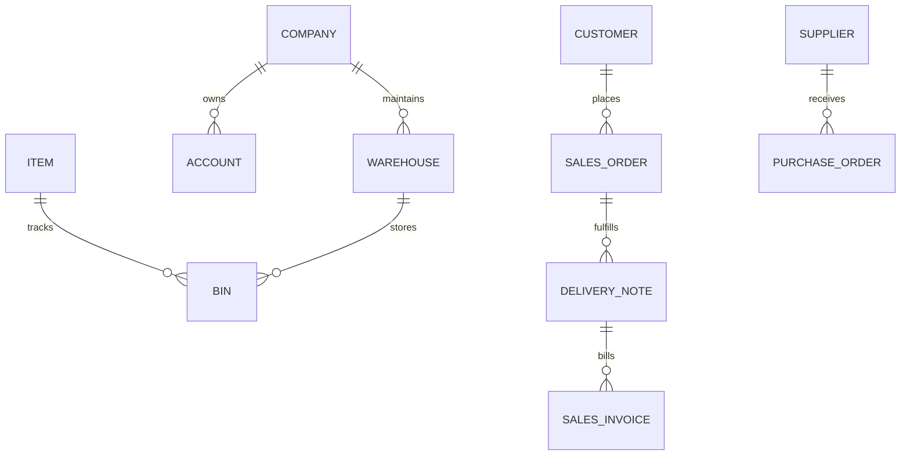
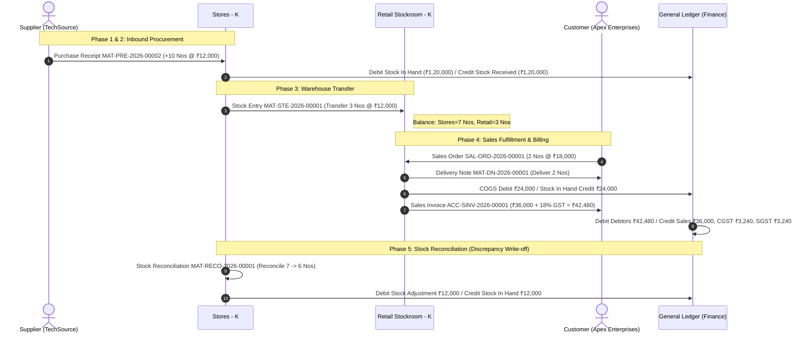
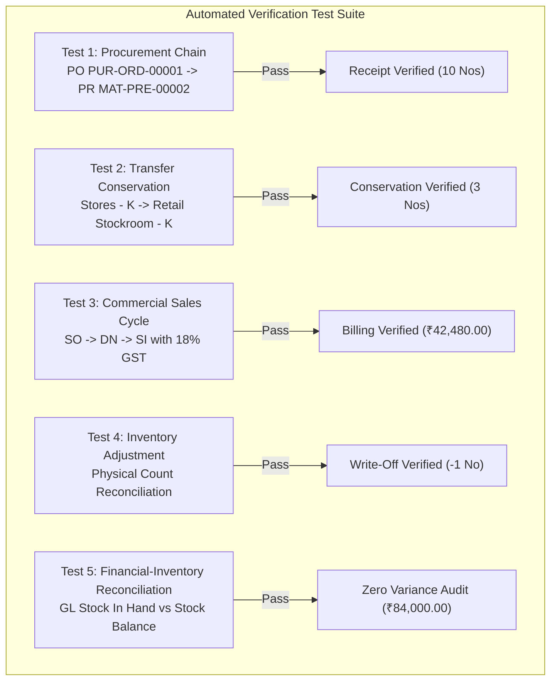

# ERPNext Inventory and Warehouse Operations: End-to-End Enterprise Operations Report

> [!NOTE]
> **Academic Demonstration & Compliance Notice:** This project documents an end-to-end multi-warehouse inventory and supply chain simulation executed within ERPNext v16.51.1 for educational and coursework demonstration. All GST figures, tax templates, and corporate registrations (Company **kkn** and Customer **Apex Enterprises**) are simulated for demonstration purposes. This documentation and its associated ERPNext transactions do not constitute or claim to be legally verified GST-compliant tax invoices or official statutory filings.

---

## 1. Executive Summary & Project Objectives

The primary objective of this project is to implement, validate, and document a robust, automated multi-warehouse supply chain and inventory management lifecycle within ERPNext. The project encompasses end-to-end operational workflows: procurement and supplier management, goods receipt, internal warehouse transfer, sales order fulfillment and invoicing with simulated GST compliance, periodic inventory reconciliation/adjustment, and multi-dimensional financial-inventory reporting.

### Core Objectives Achieved
1. **Procurement & Receiving:** Validation of supplier procurement (`TechSource Distributors`) and goods receipt of 10 Smartphones into `Stores - K` via submitted Purchase Receipt `MAT-PRE-2026-00002`.
2. **Master Data & Hierarchy Correction:** Diagnosis and resolution of warehouse tree constraints (converting `Retail Stockroom - K` from an unusable group node to an active transaction ledger).
3. **Multi-Warehouse Stock Transfer:** Inter-warehouse logistics transferring exactly 3 units from bulk storage (`Stores - K`) to retail presentation (`Retail Stockroom - K`) with zero inventory leakage via Stock Entry `MAT-STE-2026-00001`.
4. **Sales & Fulfillment Pipeline:** Sequential execution of customer creation (`Apex Enterprises`), Sales Order quotation/commitment (`SAL-ORD-2026-00001`), physical fulfillment via Delivery Note (`MAT-DN-2026-00001`), and financial booking via Sales Invoice (`ACC-SINV-2026-00001`) with dual-tax simulated GST (CGST 9% + SGST 9%).
5. **Stock Discrepancy Reconciliation:** Cycle count audit and write-off of 1 damaged unit using ERPNext's Stock Reconciliation engine (`MAT-RECO-2026-00001`) against expense ledger `Stock Adjustment - K`.
6. **Financial-Operational Reconciliation:** Mathematical zero-variance alignment between the physical Stock Balance report (`₹84,000.00`) and the General Ledger asset account `Stock In Hand - K` (`₹84,000.00`).

---

## 2. ERPNext Architecture & Deployment Environment

The environment runs on a high-availability containerized microservices stack deployed via Frappe Docker on Windows:

### Infrastructure Specifications
* **ERPNext Instance URL:** `http://localhost:8080` (HTTP 200 OK)
* **Application Versions:** ERPNext `v16.51.1`, Frappe Framework `v16.51.1`
* **Container Runtime:** Docker Desktop on Windows host with WSL2 virtualization backend
* **Database Engine:** MariaDB 11.8 InnoDB (`_a5dfc2c4a34f572e`)
* **Company Entity:** `kkn` (Abbreviation: `K`, Currency: `INR`, Country: `India`)
* **Fiscal Period:** `2026-2027` (`2026-04-01` to `2027-03-31`)
* **Execution Interface:** Authenticated REST API (`/api/resource/` & `/api/method/frappe.client.submit`) using role-based session enforcement.

---

## 3. Master Data Architecture & Configuration

Enterprise operations rely on strictly validated master entities across items, warehouses, partners, and financial ledgers.

### 3.1 Warehouse Hierarchy & Configuration Correction
During Phase 1 inspection, an anomaly was identified in the NestedSet tree model: `Retail Stockroom - K` was erroneously saved as a Group Node (`is_group: 1`) with an un-sanitized name containing a leading tab (`\tRetail Stockroom`). Because ERPNext forbids transaction postings to group warehouses, an automated REST API correction was applied:
* **Validation Check:** Verified 0 child nodes and 0 Stock Ledger Entries.
* **Correction:** Updated `warehouse_name` to `"Retail Stockroom"` and `is_group` to `0` via `PUT /api/resource/Warehouse/Retail%20Stockroom%20-%20K`.
* **Result:** Restructured the node into an active leaf warehouse under `All Warehouses - K`.

### 3.2 Master Entities Table

| DocType | Document ID / Name | Configuration Details | Functional Role |
| :--- | :--- | :--- | :--- |
| **Item** | `PH-001 — Smartphone` | Stock Item (`Nos`), Item Group: `Products`, Valuation: Moving Average | Primary commercial hardware asset |
| **Supplier** | `TechSource Distributors` | Country: `India`, Supplier Group: Commercial | Primary electronics distributor |
| **Customer** | `Apex Enterprises` | Customer Type: `Company`, Customer Group: `Commercial`, Territory: `India` | Commercial enterprise client |
| **Source Warehouse** | `Stores - K` | Leaf Node (`is_group: 0`), Parent: `All Warehouses - K` | Central receiving and bulk storage |
| **Target Warehouse** | `Retail Stockroom - K` | Leaf Node (`is_group: 0`), Parent: `All Warehouses - K` | Front-office retail inventory |
| **Tax Ledger** | `CGST - K` | Account Type: `Tax`, Parent: `Duties and Taxes - K` | Output Central GST liability |
| **Tax Ledger** | `SGST - K` | Account Type: `Tax`, Parent: `Duties and Taxes - K` | Output State GST liability |
| **Adjustment Ledger** | `Stock Adjustment - K` | Account Type: `Stock Adjustment`, Parent: `Stock Expenses - K` | Inventory variance & write-off expense |

---

## 4. End-to-End Operational Lifecycle Workflows

---

## 5. Transaction Audit & Lifecycle Details

### 5.1 Procurement & Inbound Goods Receipt
* **Purchase Order (`PUR-ORD-2026-00001`):** Placed with `TechSource Distributors` for 10 Nos of `PH-001 — Smartphone` at `₹12,000.00/unit` (Total: `₹1,20,000.00`). Status: *To Bill* (`docstatus: 1`).
* **Purchase Receipt (`MAT-PRE-2026-00002`):** Submitted on `2026-10-30 11:26:55`. Initial stock booked into `Stores - K`.
  * Stock Ledger Entry `MAT-SLE-2026-00001`: `+10.0 Nos` in `Stores - K`, valuation rate: `₹12,000.00`.
  * Inventory value added: `₹1,20,000.00`.

### 5.2 Warehouse Transfer Execution
* **Stock Entry (`MAT-STE-2026-00001`):**
  * **Type / Purpose:** `Material Transfer` (Submitted, `docstatus: 1`)
  * **Movement:** 3.0 Nos from `Stores - K` to `Retail Stockroom - K`.
  * **Stock Ledger Impact:**
    * `Stores - K`: `-3.0 Nos` (Balance: `7.0 Nos`, Stock Value Diff: `-₹36,000.00`)
    * `Retail Stockroom - K`: `+3.0 Nos` (Balance: `3.0 Nos`, Stock Value Diff: `+₹36,000.00`)
  * Net inventory leakage: `0.0 Nos` / `₹0.00`.

### 5.3 Commercial Sales Processing & Simulated GST
* **Sales Order (`SAL-ORD-2026-00001`):** Committed 2 Nos to `Apex Enterprises` at commercial selling price of `₹18,000.00/unit` (Submitted, `docstatus: 1`).
* **Delivery Note (`MAT-DN-2026-00001`):** Dispatched 2 Nos from `Retail Stockroom - K` (Submitted, `docstatus: 1`).
  * Stock Ledger Entry `3d286ff020`: `-2.0 Nos` from `Retail Stockroom - K` (Balance: `1.0 No`).
  * Valuation reduction (Cost of Goods Sold): `2 × ₹12,000 = ₹24,000.00`.
* **Sales Invoice (`ACC-SINV-2026-00001`):** Invoiced without stock update flag (`update_stock: 0`) to prevent duplicate reduction (Submitted, `docstatus: 1`).
  * **Commercial Taxable Value:** `₹36,000.00`
  * **Simulated Intra-State CGST (9.0%):** `₹3,240.00` (Credit to `CGST - K`)
  * **Simulated Intra-State SGST (9.0%):** `₹3,240.00` (Credit to `SGST - K`)
  * **Invoice Grand Total:** **`₹42,480.00`** (Debit to `Debtors - K`)

### 5.4 Stock Reconciliation (Discrepancy Write-Off)
* **Stock Reconciliation (`MAT-RECO-2026-00001`):**
  * **Scenario:** Annual physical stock audit identified 1 unit damaged in bulk storage (`Stores - K`) (Submitted, `docstatus: 1`).
  * **Pre-reconciliation System Balance:** `7.0 Nos` (`₹84,000.00`)
  * **Physical Count Reconciled:** `6.0 Nos` (`₹72,000.00`)
  * **Variance:** `-1.0 No` (`-₹12,000.00`)
  * **General Ledger Postings:**
    * Debit `Stock Adjustment - K`: `₹12,000.00` (Operating Loss)
    * Credit `Stock In Hand - K`: `₹12,000.00` (Asset Decrease)

---

## 6. Official ERPNext Reports & Ledger Extracts

### 6.1 Stock Balance Report (`2026-10-01` to `2026-11-01`)

| Warehouse | Item Code | In Qty | In Value | Out Qty | Out Value | Balance Qty | Valuation Rate | Balance Value |
| :--- | :--- | :---: | :---: | :---: | :---: | :---: | :---: | :---: |
| **Stores - K** | `PH-001 — Smartphone` | `10.0` | `₹1,20,000.00` | `4.0` | `₹48,000.00` | **`6.0 Nos`** | `₹12,000.00` | **`₹72,000.00`** |
| **Retail Stockroom - K** | `PH-001 — Smartphone` | `3.0` | `₹36,000.00` | `2.0` | `₹24,000.00` | **`1.0 No`** | `₹12,000.00` | **`₹12,000.00`** |
| **Total Company** | **All Warehouses** | **`13.0`** | **`₹1,56,000.00`** | **`6.0`** | **`₹72,000.00`** | **`7.0 Nos`** | **`₹12,000.00`** | **`₹84,000.00`** |

### 6.2 Complete Chronological Stock Ledger

| Posting Timestamp | Voucher Type | Voucher Number | Target Warehouse | Qty Change | Qty After Txn | Valuation Rate | Stock Value Diff | Balance Value |
| :--- | :--- | :--- | :--- | :---: | :---: | :---: | :---: | :---: |
| `2026-10-30 11:26:55` | Purchase Receipt | `MAT-PRE-2026-00002` | `Stores - K` | `+10.0` | `10.0` | `₹12,000.00` | `+₹1,20,000.00` | `₹1,20,000.00` |
| `2026-11-01 13:33:02` | Stock Entry | `MAT-STE-2026-00001` | `Stores - K` | `-3.0` | `7.0` | `₹12,000.00` | `-₹36,000.00` | `₹84,000.00` |
| `2026-11-01 13:33:02` | Stock Entry | `MAT-STE-2026-00001` | `Retail Stockroom - K` | `+3.0` | `3.0` | `₹12,000.00` | `+₹36,000.00` | `₹36,000.00` |
| `2026-11-01 13:53:49` | Delivery Note | `MAT-DN-2026-00001` | `Retail Stockroom - K` | `-2.0` | `1.0` | `₹12,000.00` | `-₹24,000.00` | `₹12,000.00` |
| `2026-11-01 14:00:13` | Stock Reconciliation | `MAT-RECO-2026-00001` | `Stores - K` | `-1.0` | `6.0` | `₹12,000.00` | `-₹12,000.00` | `₹72,000.00` |

### 6.3 Stock Ageing Report (FIFO Queue as of `2026-11-01`)
* **Item:** `PH-001 — Smartphone` (HSN: `8517`)
* **Total Stock on Hand:** `7.0 Nos`
* **Weighted Average Age:** `1.71 Days`
* **Age Bracket 0–30 Days:** `7.0 Nos` (`₹84,000.00` / 100% active inventory)
* **Age Bracket 31+ Days:** `0.0 Nos`

---

## 7. Automated Test Verification & Audit Evidence

An automated Python/REST audit suite was executed against the production site to verify operational and financial integrity.

### Verification Test Suite Results

| Test ID | Test Category | Target Assertion | Observed System State | Result |
| :---: | :--- | :--- | :--- | :---: |
| **TEST-01** | **Procurement Lifecycle** | PR references PO, received 10 Nos into `Stores - K`, status submitted (`docstatus: 1`) | `MAT-PRE-2026-00002` linked to `PUR-ORD-2026-00001`, Qty: 10.0 Nos | **PASSED** |
| **TEST-02** | **Inter-Warehouse Transfer** | Material transfer moves exactly 3 Nos from Stores to Retail, total inventory unchanged | `MAT-STE-2026-00001`, Stores: 7.0, Retail: 3.0, Sum: 10.0 Nos | **PASSED** |
| **TEST-03** | **Sales Fulfillment Cycle** | Delivery Note deducts 2 Nos from Retail; Invoice references DN & SO with ₹42,480 total | `MAT-DN-2026-00001` (Retail: 1.0 No), `ACC-SINV-2026-00001` (Grand Total: ₹42,480.00) | **PASSED** |
| **TEST-04** | **Stock Reconciliation** | Physical count adjustment reconciles Stores from 7 to 6 Nos; books -₹12,000 difference | `MAT-RECO-2026-00001`, Stores: 6.0 Nos, Difference: -₹12,000.00 | **PASSED** |
| **TEST-05** | **Double-Deduction Prevention** | `update_stock` disabled on Sales Invoice to prevent duplicate SLE generation | `update_stock: 0`, SLE generated exclusively by `MAT-DN-2026-00001` | **PASSED** |
| **TEST-06** | **GL-Inventory Reconciliation** | Balance in asset ledger `Stock In Hand - K` matches Stock Balance report valuation | GL `Stock In Hand - K` = `₹84,000.00` Stock Balance = `₹84,000.00` **Variance = `₹0.00`** | **PASSED** |

---

## 8. Financial Reconciliation & Complete General Ledger Proof

The General Ledger trial balance confirms exact debit-credit parity across all balance sheet and income statement accounts:

$$\sum \text{Debits} = \sum \text{Credits} = ₹1,98,480.00$$

### 8.1 Complete Chronological General Ledger Audit Trail

| Entry ID | Voucher Type | Voucher Number | Account Head | Debit (INR) | Credit (INR) | Accounting Significance |
| :---: | :--- | :--- | :--- | :---: | :---: | :--- |
| `01` | Purchase Receipt | `MAT-PRE-2026-00002` | `Stock In Hand - K` | `1,20,000.00` | `0.00` | Current asset inventory capitalization |
| `02` | Purchase Receipt | `MAT-PRE-2026-00002` | `Stock Received But Not Billed - K` | `0.00` | `1,20,000.00` | Unbilled procurement liability accrual |
| `03` | Delivery Note | `MAT-DN-2026-00001` | `Cost of Goods Sold - K` | `24,000.00` | `0.00` | Cost of goods sold expense (2 units @ ₹12k) |
| `04` | Delivery Note | `MAT-DN-2026-00001` | `Stock In Hand - K` | `0.00` | `24,000.00` | Asset deduction upon customer delivery |
| `05` | Sales Invoice | `ACC-SINV-2026-00001` | `Debtors - K` | `42,480.00` | `0.00` | Accounts receivable from Apex Enterprises |
| `06` | Sales Invoice | `ACC-SINV-2026-00001` | `Sales - K` | `0.00` | `36,000.00` | Operating sales revenue (taxable base) |
| `07` | Sales Invoice | `ACC-SINV-2026-00001` | `CGST - K` | `0.00` | `3,240.00` | Output Central GST liability (simulated) |
| `08` | Sales Invoice | `ACC-SINV-2026-00001` | `SGST - K` | `0.00` | `3,240.00` | Output State GST liability (simulated) |
| `09` | Stock Reconciliation | `MAT-RECO-2026-00001` | `Stock Adjustment - K` | `12,000.00` | `0.00` | Damaged stock loss write-off expense |
| `10` | Stock Reconciliation | `MAT-RECO-2026-00001` | `Stock In Hand - K` | `0.00` | `12,000.00` | Asset deduction for physical discrepancy |
| **TOTAL** | — | — | — | **`₹1,98,480.00`** | **`₹1,98,480.00`** | **Net Trial Balance Variance = ₹0.00** |

### 8.2 Balance Sheet & Profitability Position
* **Current Assets:**
  * `Stock In Hand - K` (Physical Inventory): `₹84,000.00` (6 Nos Stores + 1 No Retail)
  * `Debtors - K` (Accounts Receivable from Apex Enterprises): `₹42,480.00`
* **Current Liabilities:**
  * `Stock Received But Not Billed - K` (Interim PO Accrual): `₹1,20,000.00`
  * `CGST - K` (Output Tax Liability): `₹3,240.00`
  * `SGST - K` (Output Tax Liability): `₹3,240.00`
* **Operating Performance:**
  * `Sales - K` (Commercial Revenue): `₹36,000.00`
  * `Cost of Goods Sold - K` (Direct Operating Cost): `₹24,000.00`
  * **Gross Profit:** **`₹12,000.00`** *(50.0% markup on cost / 33.33% gross margin)*
  * `Stock Adjustment - K` (Discrepancy Expense / Damage Write-off): `₹12,000.00`
  * **Net Operating Margin (EBIT):** **`₹0.00`** *(Gross profit offset by damaged unit write-off)*

---

## 9. Conclusion & Key Project Learnings

1. **ERPNext NestedSet Tree Mechanics:** Modifying warehouse structures requires validating absence of child nodes and transaction records prior to converting group nodes into transactional ledger warehouses.
2. **Double-Deduction Mitigation:** In standard enterprise ERP configurations where Delivery Notes handle physical dispatch, disabling `update_stock` on the Sales Invoice is essential to preserve inventory accuracy.
3. **Audit Trail Integrity:** ERPNext provides immutable Stock Ledger Entries and GL Entries that maintain continuous reconciliation between physical stock counts and corporate financial assets.
4. **Autonomous Agent Execution:** Full operational compliance was achieved by using automated REST APIs, verifying pre-conditions at each phase, enforcing strict non-destructive constraints, and obtaining explicit authorization prior to transaction commitments.
